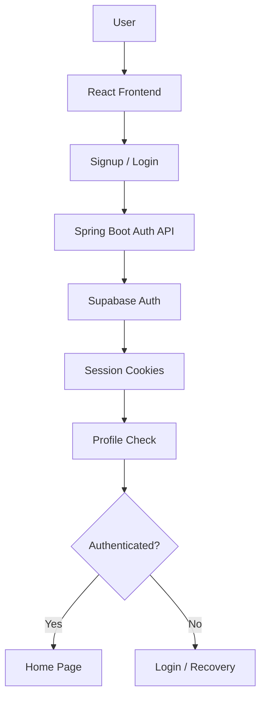
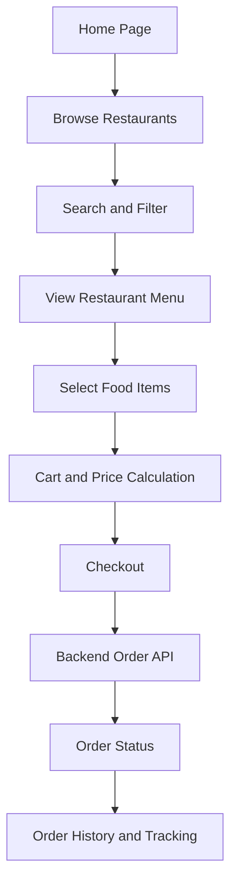
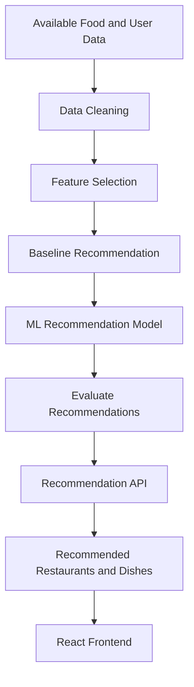

HUNGRY HOUR — Food Ordering & Delivery Platform

HUNGRY HOUR is a food ordering and delivery platform designed to help users discover restaurants, explore menus, and order food through a responsive web interface. The project integrates a React frontend with a Spring Boot backend, Supabase authentication, and a planned ML-based food recommendation feature.   
deployed link https://hungry-hour-food-order-and-delivery.vercel.app/

### Intro splash and backend availability check

Opening `/` plays the HUNGRY HOUR burger intro and then navigates to `/login`. If the backend developer provides a public, unauthenticated GET endpoint, set its exact path in `VITE_PUBLIC_HEALTH_PATH`. The splash calls only that configured path using `VITE_API_BASE_URL`; if it is unset, no wake-up request is made. The splash proceeds on its own schedule whether the request succeeds, fails, or times out, and does not indicate backend health. Direct visits to `/login` do not play the intro.

**Completed frontend work:
React application setup and authentication pages.
Signup, login, forgot-password, and update-password interfaces.
Integration with the existing Spring Boot authentication endpoints.
Cookie-based API requests through authService.js.
Protected home route using ProtectedRoute.jsx.
Logout action in the navigation bar.
Session refresh and error-handling logic in the API client.
Production build verification using npm run build.

Still requiring verification or further work:
End-to-end authentication testing with the deployed backend.
Production CORS and cookie configuration.
Email verification and password-recovery flows.
Backend logout/session invalidation behavior.
Restaurant discovery, cart, checkout, orders, and other features according to the final project scope.
ML recommendation implementation and evaluation.
                
                Project Architecture
Frontend: Provides the user interface, authentication forms, navigation, and customer-facing food-ordering experience.
Backend: Handles API requests, business logic, authentication integration, and application operations supported by the backend.
Supabase Auth: Supports user authentication and password-recovery operations through the backend.
ML Component: Aims to recommend relevant restaurants or dishes based on suitable data, ratings, cuisine, prices, and user preferences.
Database and Data Storage: Store application information through the configured backend and data services. The exact database responsibilities should be confirmed from the backend implementation

 Authentication Workflow

HUNGRY HOUR uses a React frontend integrated with Spring Boot authentication APIs and Supabase Auth.

Signup and Login

The user submits signup or login details through the frontend.
authService.js sends the request to the backend.
The backend communicates with Supabase Auth.
After successful login, the backend is expected to establish the configured session cookies.
The frontend navigates to /home.

Protected Home Route

ProtectedRoute.jsx checks the session through the profile API.
A successful profile request allows the Home page to render.
If authentication fails with 401 after the refresh attempt, the user is redirected to login.
HUNGRY HOUR uses a React frontend integrated with Spring Boot authentication APIs and Supabase Auth.
Session Refresh

The API client attempts to refresh an eligible expired session and retry the original request. The deployed refresh behavior still requires end-to-end testing.

Logout

The navbar logout action calls the backend logout endpoint through authService.js. Successful session invalidation and cookie clearing must be verified against the deployed backend.

Password Recovery

The frontend submits the user's email to the forgot-password endpoint. The intended recovery flow uses a backend callback and an update-password request. Email delivery, callback redirects, and successful password changes require end-to-end verification.
Planned Food Ordering Workflow

The intended customer journey includes:

Browse restaurants.
Search and filter restaurants.
View restaurant details and menus.
Select food items and manage the cart.
Review prices and proceed to checkout.
Handle supported payment states.
View order history and delivery status.
Receive relevant food recommendations.
##  Project Workflow

### Authentication Flow

### Food Ordering Flow

### ML Recommendation Flow

